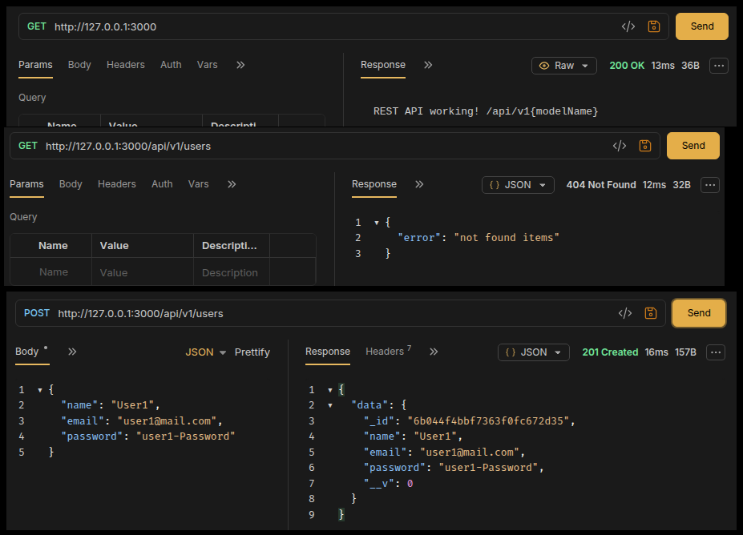
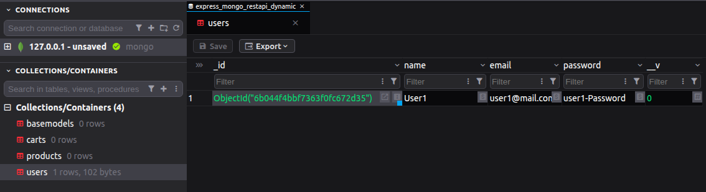

# Express Mongo RESTApi with dynamic models

- Example RESTApi for mongodb
- Schema with model addition in `models/schemas`
- Returns errors corresponding to RESTApi HTTP codes

## Installation

- debian linux recomended (ubuntu, mint, debian)
- install mongodb (see DeepSeek or Google AI for info)
- install nodejs (see DeepSeek or Google AI for info)
- also can other platforms but not tested

## Run 

- install dependenties
  - cd express_mongo_restapi_dynamic
  - npm i 
  - npm i -g nodemon
- edit env.js if needed
  - `config/env.js`
    - port = 3000
    - hist = 127.0.0.1
- node src/restapi 
  - at http://127.0.0.1:3000

## Unit tests

Set up
- `node src/restapi test_db`

Run test 
- `node node_modules/.bin/ava`
- `npm run test`

Single file run
- `npm run test -- tests/common/email.test.js`
- ...

## Example - Bruno

[Bruno docs](https://docs.usebruno.com/)

Database:


## Router

- name
  - user, product, cart

- `src/routers/restapi`
  - URL prefix
    - /api/v1 : `constants/apiv1.js`
  - GET
    - /:name/:id
    - /:name
    - /:name?page=1
    - /:name?page=1&limit=10
    - /:name?page=1&limit=10&sort=_id (other fields)
  - DELETE
    - /:name/:id
  - POST type json (insert)
    - /:name
      - `{ field: value }`
  - PUT type json (update)
    - /:name/:id
      - `{ field: value }`

## Database

- mongodb is used
- mongoose is used

### BaseModel

- Used for typing parameters in code

Example
```js
/**
 * @param {string} name 
 * @returns {BaseModel | undefined}
 */
getClass(name) {
  return this.#classes[name];
}
```

### Schema

- List of models, other models can be added
- `src/models/schemas`
  - user
    - name
    - email
    - password
  - product
    - title
    - price
  - cart
    - userId = user._id
    - product = product
    - count

## License
- [MIT](LICENSE.md)